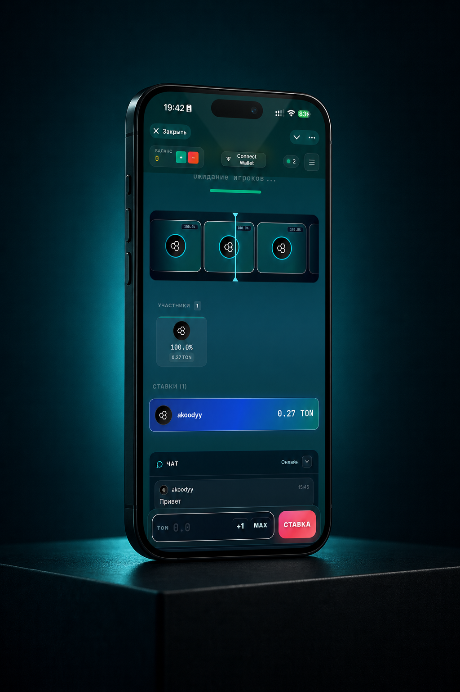

# TONanza

[](https://github.com/akoody/TONanza/actions/workflows/ci.yml)

TONanza is a Telegram Mini App for a TON-based jackpot casino experience. Players enter fast PvP jackpot rounds, place TON-denominated bets, watch the live pot grow, and see the winner selected through a provably-fair round flow.

The project is built as a full-stack TypeScript product: a mobile-first Telegram WebApp client, a Node.js backend, PostgreSQL persistence, Socket.IO realtime updates, TON wallet/deposit infrastructure, game history, referrals, and in-game chat.



## Stack

- Node.js 20, TypeScript, Fastify
- PostgreSQL and Prisma ORM
- Socket.IO for live game state and chat updates
- Telegram Mini Apps / Telegram WebApp SDK
- TON wallet, deposit watcher, and payout service modules
- React 18, Vite, Tailwind/PostCSS
- Docker and Docker Compose for deployment

## Product Scope

- Jackpot PvP game loop with active rounds and winner history
- TON-denominated betting UI with compact mobile controls
- Provably-fair seed utilities for transparent winner selection
- Real-time pot, players, roulette, chat, and round-state updates
- TON payment/deposit UX for Telegram Mini App users
- Referral and onboarding flows
- Admin/moderation foundations for chat and operational control

## Repository Layout

```text
.
├── src/
│   ├── game/             # Jackpot round and provably-fair game domain
│   ├── wallet/           # TON deposit, entropy, and payout services
│   ├── chat/             # In-game chat schemas, moderation, persistence
│   ├── bot/              # Telegram bot integration
│   ├── http/             # Routes, Telegram auth, security hooks
│   ├── realtime/         # Socket.IO server and chat events
│   ├── referrals/        # Referral balance operations
│   ├── app.ts            # Application assembly
│   └── server.ts         # Entrypoint
├── frontend/             # Telegram Mini App casino client
├── prisma/               # Prisma schema and migrations
├── Dockerfile            # Production backend image
├── docker-compose.yml    # PostgreSQL + backend runtime
└── deploy.sh             # Optional SSH deploy helper
```

## Fairness

Each round commits to a server seed by publishing `sha256(serverSeed)` before bets close. The client seed is taken from the latest TON masterchain block (`seqno:root_hash:file_hash`), which the server cannot choose. After the round:

```
winningTicket = (sha256(serverSeed:clientSeed) % totalTickets) + 1
```

`GET /v1/games/:gameId/fairness` reveals the server seed and returns everything needed to recompute the winner. If the TON API is unavailable when a round resolves, the server generates the client seed itself; such seeds start with `fallback:` and the endpoint reports `clientSeedSource: "server-fallback"`, so those rounds are not independently verifiable.

## Security

- Every request is authenticated with Telegram `initData`: HMAC checked in constant time, `auth_date` limited by `TELEGRAM_AUTH_MAX_AGE_SECONDS`.
- Balances are integer nanotons; bets and withdrawals use guarded atomic decrements, withdrawals are claimed with a `PENDING → PROCESSING` transition before any transfer.
- Withdrawals run one at a time because the wallet only accepts the next `seqno`. A failed API response proves nothing, so the outcome is read from the wallet: `seqno` advanced means sent, unchanged after the message expires means safe to refund, and anything else is left for manual review.
- Development helpers (auth bypass headers, test balance top-up, bootstrap balance, manual watcher poll) require both `NODE_ENV=development` and `DEV_TOOLS_ENABLED=true`. In production the server refuses to start with them enabled or without `TELEGRAM_BOT_TOKEN`, and `deploy.sh` refuses a non-production `.env`.
- HTTP, socket connection and socket event rate limits; security headers and a strict CSP on API responses.

## Development

```bash
cp .env.example .env          # set DATABASE_URL, APP_WALLET_ADDRESS; DEV_TOOLS_ENABLED=true for local auth bypass
npm ci && npm --prefix frontend ci --legacy-peer-deps
npx prisma migrate dev
npm run dev                   # API
npm run frontend:dev          # Mini App
```

`npm run check` runs the TypeScript check, tests and the frontend build; CI runs it on every pull request. Tests cover the provably fair derivation, Telegram `initData` validation, configuration guards and round seed sources. `npm run test:db` runs the game and money flows against PostgreSQL (a database from `DATABASE_URL` with migrations applied): simultaneous bets, double spends, cancellation, resolution and proofs, one-time prize and referral payouts, and every withdrawal outcome.

## Known limitations

- Rate limit state lives in process memory, so limits are per instance.
- `frontend/src/App.tsx` still holds the round state machine (spin timing, prize claim, reconnects) in about 1,400 lines.
- A withdrawal whose outcome could not be determined stays in `PROCESSING` with a note and needs manual review.

## License

[MIT](LICENSE)
